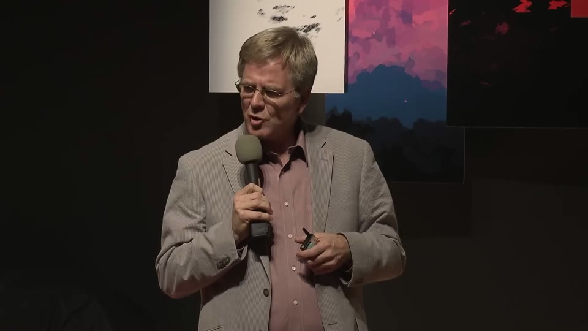
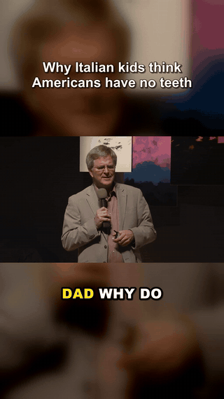
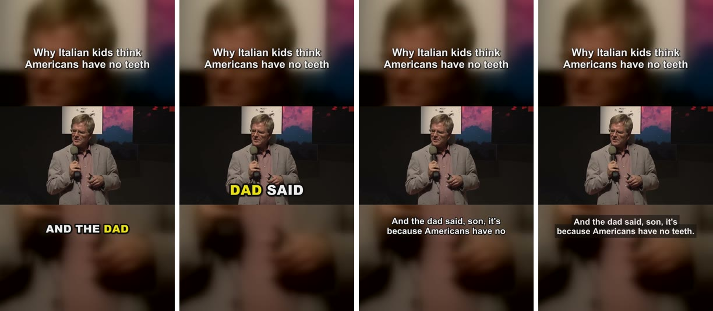

# YT2clips

**Paste a YouTube link, get TikToks, Shorts and Reels.** A Claude Code skill that finds the best
moments in a video, cuts them on exact word boundaries, reformats them for vertical screens and
burns in animated captions.

[](LICENSE)
[](https://www.python.org/downloads/)
[](https://docs.anthropic.com/en/docs/claude-code)
[](https://github.com/kobski001/YT2clips/releases)

<table>
  <tr>
    <th>Before: a 21-minute 16:9 talk</th>
    <th>After: a 30-second 9:16 clip</th>
  </tr>
  <tr>
    <td align="center"></td>
    <td align="center" rowspan="2"></td>
  </tr>
  <tr>
    <td>
      One prompt:<br>
      <code>Make a TikTok from https://youtube.com/watch?v=kYXiegTXsEs</code><br><br>
      Claude picked the moment, wrote the title, cut it on word boundaries, kept the whole frame
      over a blurred background and added karaoke captions.
    </td>
  </tr>
</table>

<sub>Demo footage: <a href="https://www.youtube.com/watch?v=kYXiegTXsEs">"The value of travel" by Rick Steves, TEDxRainier</a>
(TEDx Talks), licensed <a href="https://creativecommons.org/licenses/by/3.0/">CC BY 3.0</a>. Clipped and reformatted with YT2clips.</sub>

## Quick start

```bash
git clone https://github.com/kobski001/YT2clips.git
cd YT2clips
bash install_as_skill.sh        # Windows PowerShell: .\install_as_skill.ps1
```

Then in Claude Code:

```
Make 3 TikToks and a YouTube highlight from https://www.youtube.com/watch?v=VIDEO_ID
```

You'll need Python 3.9+, FFmpeg with libass, and deno ([install table below](#installation)).

## What's new in v2.1

- **Blurred-background vertical clips (now the default).** The whole original frame stays
  visible at full width over a zoomed, blurred copy, so nobody gets cropped out of a wide shot.
- **Title in the top band.** Each clip's title is shown above the video. Use `title_text` to
  change it, or `""` to hide it.

## What it does

- **Downloads** the video with its chapters and YouTube's "most replayed" heatmap.
- **Transcribes** with Whisper (faster-whisper) for word-level timing, using the GPU when
  available. YouTube captions are the fallback.
- **Finds the moments.** Claude reads a numbered transcript marked with pauses, chapters and
  replay peaks, then proposes clips per platform: hook-first shorts and full-story long cuts.
- **Cuts on word boundaries,** with natural breathing room, so nothing starts or ends mid-word.
- **Renders in one FFmpeg pass:** cut, reframe, captions, audio fades and loudness normalised
  to -14 LUFS.
- **Writes `clips.md`** with titles, captions and hashtags ready to paste, plus a clean `.srt`
  per clip.

### Platforms

| Platform | Aspect | Target length | Default captions |
|---|---|---|---|
| TikTok | 9:16 | 21-60s | karaoke |
| YouTube Shorts | 9:16 | 30-58s | karaoke |
| Instagram Reels | 9:16 | 15-60s | karaoke |
| YouTube | 16:9 | 3-10 min | classic |

Any clip can also be rendered in 1:1 or 4:5.

### Reframing (16:9 to vertical)

- **blur** (default): the whole original frame at full width, over a zoomed, blurred copy that
  fills the screen. The clip title goes in the top band and captions in the bottom band.
- **auto**: follows the speaker's face (OpenCV YuNet) with steady holds and clean switches.
- **crop**: fixed crop position.
- **fit**: letterbox with black bars.

### Caption styles

<p align="center">
  
  <br><sub>karaoke · pop · classic · boxed</sub>
</p>

- **karaoke**: 2-4 bold words at a time; the spoken word lights up.
- **pop**: 1-2 big words with a pop-in animation.
- **classic**: YouTube-style, two lines with an outline.
- **boxed**: text on a translucent box.

Captions are sized in output pixels, wrapped to fit the frame, and kept clear of the
TikTok/Shorts UI.

## Installation

Requirements: Python 3.9+, FFmpeg with libass, and a JS runtime for yt-dlp
([deno](https://deno.com)).

| OS | FFmpeg | deno |
|---|---|---|
| Windows | `winget install Gyan.FFmpeg` | `winget install DenoLand.Deno` |
| macOS | `brew install ffmpeg-full` | `brew install deno` |
| Linux | `sudo apt install ffmpeg` | `curl -fsSL https://deno.land/install.sh \| sh` |

Then clone the repo and install the skill:

```bash
git clone https://github.com/kobski001/YT2clips.git
cd YT2clips
```

```bash
# macOS / Linux / Git Bash
bash install_as_skill.sh
```
```powershell
# Windows PowerShell
.\install_as_skill.ps1
```

This copies the skill to `~/.claude/skills/youtube-clipper/`, installs the Python packages in
`requirements.txt` (yt-dlp, faster-whisper, opencv-python-headless) and runs an environment
check. Run it again to update.

**NVIDIA GPU on Windows:** `pip install nvidia-cublas-cu12` lets Whisper run on the GPU with
the large-v3-turbo model, which is faster and more accurate than the CPU default (small.en).
The 21-minute demo video above transcribed in under 3 minutes this way.

## Usage

In Claude Code:

```
Make 3 TikToks and a YouTube highlight from https://www.youtube.com/watch?v=VIDEO_ID
```

Claude checks the environment, asks about platforms and caption style, then downloads,
transcribes, proposes clips, previews the framing and renders.

Output:

```
youtube-clips/<video_id>/
├── clips.md                        # titles, timings, captions, hashtags
├── 01_Life_will_hit_you_with_a_brick/
│   ├── 01_..._tiktok_9x16.mp4
│   └── 01_....srt                  # clean captions for upload
└── 02_Love_and_loss/
    ├── 02_..._youtube_16x9.mp4
    ├── 02_..._youtube_9x16.mp4
    └── 02_....srt
```

### Using the scripts directly

```bash
S=~/.claude/skills/youtube-clipper/scripts
python $S/download_video.py "https://youtu.be/VIDEO_ID" youtube-downloads
python $S/transcribe.py youtube-downloads/VIDEO_ID.mp4
python $S/prepare_transcript.py youtube-downloads/VIDEO_ID.transcript.json --meta youtube-downloads/VIDEO_ID.meta.json
# write clip_plan.json (format in SKILL.md), then:
python $S/render_clips.py clip_plan.json --check
python $S/render_clips.py clip_plan.json --preview
python $S/render_clips.py clip_plan.json

# or a single clip from raw times:
python $S/render_clip.py video.mp4 transcript.json 8:11.6 8:54.4 out.mp4 --aspect 9:16 --style karaoke --title "My hook"
```

## Configuration

Copy `.env.example` to `.env` (in the skill folder or your working folder). Options include
the Whisper model and device, the encoder (`VIDEO_ENCODER=nvenc` for GPU encoding), x264
quality, caption font and highlight colour, a custom fonts folder, and a yt-dlp proxy or
cookies.

## Scripts

| Script | Purpose |
|---|---|
| `check_env.py` | Checks dependencies and prints install hints |
| `download_video.py` | Downloads video, captions, chapters and heatmap |
| `transcribe.py` | Whisper word-level transcript (or `--from-captions`) |
| `prepare_transcript.py` | Builds the numbered sentence list used to pick clips |
| `render_clips.py` | Batch: plan → check → preview → render → `clips.md` |
| `render_clip.py` | Renders one clip (cut + reframe + captions + audio) |
| `transcript.py` | Transcript model, caption parsing, sentence building, cut snapping |
| `subtitles.py` | ASS caption styles, title overlay and SRT export |
| `reframe.py` | Face tracking and crop planning |
| `presets.py` | Platform and aspect presets |

## License

MIT. Based on [op7418/Youtube-clipper-skill](https://github.com/op7418/Youtube-clipper-skill).
Demo footage in `assets/` is from a CC BY 3.0 video (credited above) and isn't covered by the
MIT licence.
